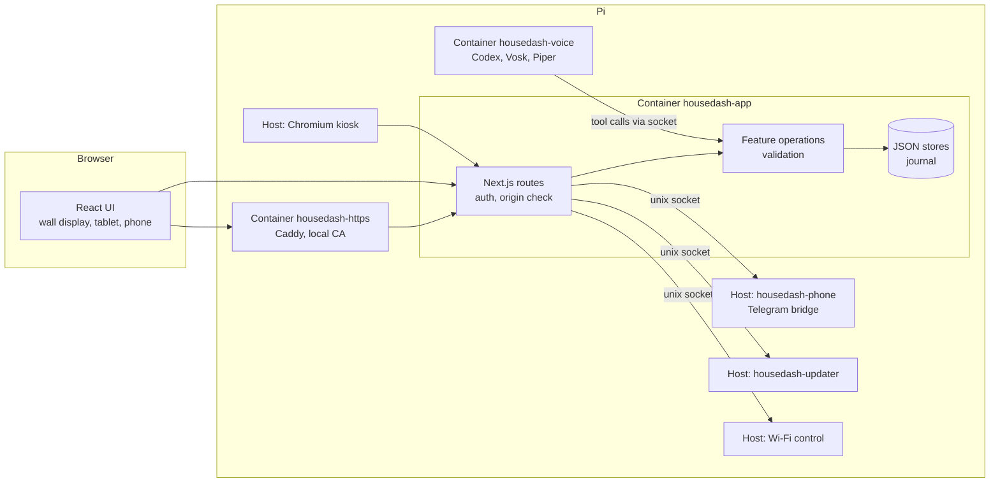

# Architecture

HouseDash is a modular Next.js monolith with **one writing Node process**. A feature has one domain
implementation that the UI, the HTTP API and the voice assistant share. Small host services do what a
container should not do.



## Containers and host services

| Part | Runs as | Purpose |
|---|---|---|
| `housedash-app` | container, UID 1000 | UI, API, all family data (`/app/data`, photos) |
| `housedash-https` | container, UID 1000 | Caddy with a local certificate authority, ports 80/443 |
| `housedash-voice` | container, read-only root, no capabilities | Codex app server (OpenAI login), Vosk speech recognition, Piper speech |
| `housedash-phone` | host systemd service | Telegram calls with PyTgCalls/NTgCalls; audio via PulseAudio or the caller's browser |
| `housedash-phone-control`, `housedash-wifi-control` | socket-activated, root | one fixed action each (restart the phone service, Wi-Fi scan/connect) |
| `housedash-updater` | host systemd service | signed updates from GitHub Releases ([UPDATES.md](UPDATES.md)) |
| `housedash-kiosk` | host systemd service | Chromium on labwc on tty1; starts only when a display is connected |

The app container never gets the Docker socket or host privileges. Each host service listens on a private
Unix socket (mode 0600, the Pi's first user) that is bind-mounted read-only into the app container.

## Source layout

```text
src/app/                 Next.js app: /family (UI shell), /login, API routes (thin HTTP adapters)
src/app/family/          app shell, sidebar, settings list, shared UI helpers
src/features/<feature>/  one folder per feature
  shared.ts              browser-safe types
  components/            UI
  server/service.ts      domain logic, validation, stores
  server/queries.ts      read operations
  server/commands.ts     write operations (confirm / undo)
  server/tools.ts        operation names, descriptions, input schemas (UI + AI)
src/features/shared/     operation registry, validation, client API (callFeature)
src/lib/                 infrastructure: auth, config, data transaction journal, backups, weather, time zones
phone/                   Telegram bridge and the fixed control actions (Python)
voice/                   voice broker (Python, aiohttp, Codex JSON-RPC)
updater/                 updater service and the release public key
https/                   Caddy configuration
scripts/                 deploy, setup, migration, release and maintenance scripts
```

Features: calendar, tasks, transit, waste, weather (incl. room sensor), brain, household, phone, network,
intelligence, software.

## Shared operations

- `GET /api/family/features` lists every operation with its input schema.
- `POST /api/family/features` runs one: `{ "operation": "housedash_calendar", "args": { … } }`.
- The voice assistant gets the same operations as Codex dynamic tools. Only the presentation differs:
  bounded results, local times instead of UTC, no URLs with tokens.
- Deleting and calling are prepared and need a tap to confirm. Other changes happen at once and offer *undo*.
  Confirmation and undo ids are short-lived, in memory and bound to the session.

## Data

All data is JSON under `/app/data` in the volume `housedash_data`, written only through
`withDataTransaction` (one journal, `.bak` copies, crash recovery). See [DATA.md](DATA.md).

## Security model

- One family password (optional). Session cookie `hs-session`, signed; IP allowlist optional.
- Write requests must come from the same origin. A proxy stamps the client IP; `X-Forwarded-For` is not trusted.
- The calendar feed needs a random 256-bit token and a private client address.
- Secrets (`secrets.json`, Telegram session, voice login, TLS keys) never leave the Pi except in a backup the
  user explicitly requests; credential backups can be encrypted with a passphrase.
- Updates are only installed if their Ed25519 signature matches `updater/release-public-key.pub`.

See also [SECURITY.md](../SECURITY.md).
